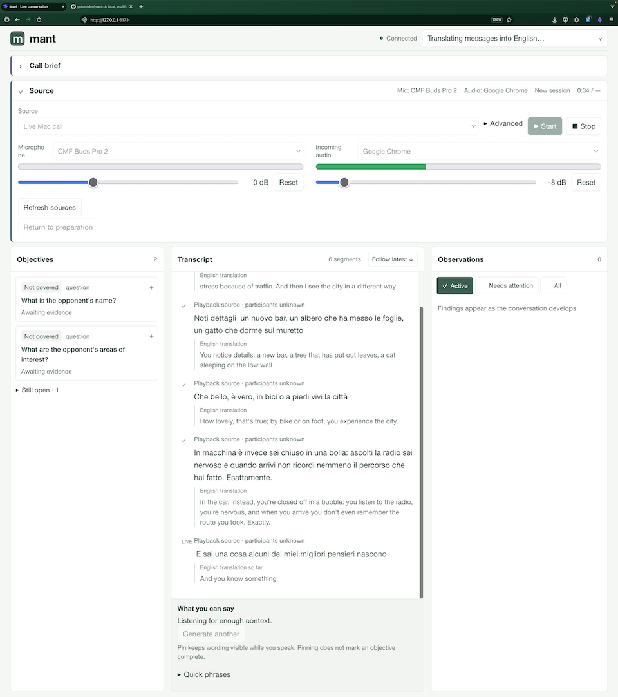

# Mant

A local, multilingual assistant that helps you prepare before a call, then follows the live transcript, tracks your objectives, and suggests replies during the conversation automatically.

**Version 0.0.1 · Early development.** Designed for one person running it locally.

## Demos

### Capture a call



Usage videos coming soon.

## Requirements

- **Bun 1.4.4** (the pinned development and CI version).
- **FFmpeg** on your PATH; tested with **9.0.2**.
- An **OpenAI API key** with access to the configured models for transcription and AI features. These requests incur API charges. Saved replay works without a key when model features are disabled.
- For live Mac capture: **macOS 13+** and **Xcode Command Line Tools**. Transcribing files does not require the native helper.

## Get started

Clone or download this repository, then run from its directory:

```sh
bun install --frozen-lockfile
export OPENAI_API_KEY="your-api-key"
bun run dev
```

Open **http://127.0.0.1:5173**. Set your languages in **Call brief**, enter your goals, and choose **Build objectives**. Under **Source**, add a recording or choose a saved session, then press **Start**.

For live Mac calls, first run `bun run capture:build`, then choose **Live Mac call**, your microphone, and the incoming application or routed input. Follow the [Mac capture setup](docs/macos-capture.md) for permissions and routing.

To run the built app:

```sh
bun run build
bun run start
```

Open **http://127.0.0.1:3001**.

## Configuration and data

Set configuration in the server process environment. Scripts deliberately ignore `.env` files.

| Variable         | Default            | Purpose                                     |
| ---------------- | ------------------ | ------------------------------------------- |
| `OPENAI_API_KEY` | —                  | Server-side API credential                  |
| `PORT`           | `3001`             | Server port; development proxy expects 3001 |
| `TRANSCRIPT_DIR` | `data/transcripts` | Storage directory, relative to the project  |
| `ANALYSIS_MODEL` | `gpt-6-luna`       | Interpretation and translation model        |
| `SUGGEST_MODEL`  | Analysis model     | Reply suggestion model                      |

The server listens on loopback. Recordings, transcripts, and saved briefs stay on disk; audio and conversation context are sent to the model provider when the corresponding AI features run. API keys stay on the server. Local data is ignored by Git and is never automatically deleted.

## Development

Built with **React 19.3.1**, **TypeScript 7.0.2**, **Vite 8.3.5**, **Oxlint 1.90.0**, and **Pi 1.4.0**. Exact dependency resolutions are recorded in `bun.lock`.

```sh
bun test
bun run lint
bun run build
```

The build includes type checking; `bun run typecheck` runs it separately. Tests use fake model transports and make no paid requests. CI runs the checks on Linux and macOS and compiles the Mac capture helper.

See [contributing](CONTRIBUTING.md) and the [changelog](CHANGELOG.md).

## Learn more

- [Call briefs, objectives, languages, and replay](docs/conversation-tracking.md)
- [Reply suggestions](docs/predictive-replies.md)
- [Mac capture setup](docs/macos-capture.md)
- [Grounding, corrections, and usage](docs/grounding-and-usage.md)
- [Diagnostics](docs/transcription-isolation.md)

Model findings can be wrong. There is no automatic speaker diarization; call capture and audio separation depend on the application and hardware. Historical journals using retired schemas may no longer load.

Licensed under the [MIT License](LICENSE).
